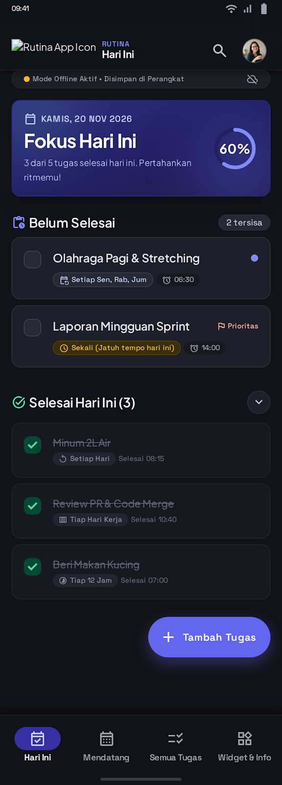
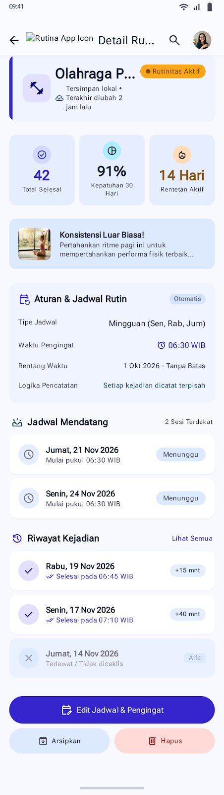
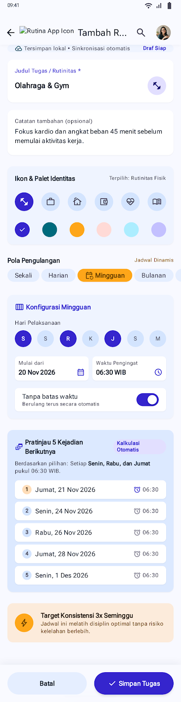
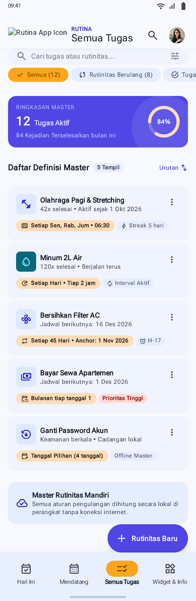
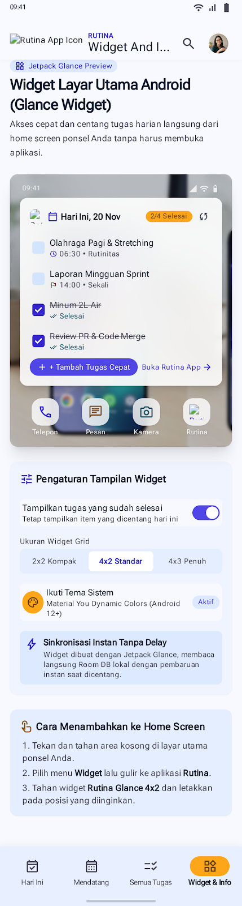

<p align="center">
  
</p>

<h1 align="center">Rutina</h1>

<p align="center">
  <b>A modern, offline-first personal task and recurring routine manager for Android.</b>
</p>

<p align="center">
  
  
  
  
  
  
  
</p>

---

## 📖 Overview

**Rutina** is designed for individuals who want a clean, lightning-fast, and distraction-free way to manage both one-time tasks and habitual routines. 

Unlike conventional to-do apps that simply push due dates forward, Rutina features a dedicated **recurrence engine** that cleanly decouples **Task Definitions** from individual **Scheduled Occurrences**. Checking off an exercise routine today creates a distinct historical record while leaving future schedule occurrences intact.

Built completely offline-first with **Jetpack Compose**, **Room**, and **Jetpack Glance**, Rutina requires no accounts, no subscriptions, and zero internet connection—your routines remain private on your device.

---

## ✨ Features

- **🔄 Flexible Recurrence Engine**:
  - One-time tasks with specific calendar dates.
  - Daily routines with custom day intervals (e.g., *every 3 days*).
  - Weekly routines tied to specific weekdays (e.g., *Mon, Wed, Fri*).
  - Monthly routines anchored to day-of-month (e.g., *every 1st*).
  - Custom date lists and optional start/end bounds.
- **🧩 Task Definition vs. Occurrence Separation**:
  - Completing today's occurrence never mutates previous history or overwrites the master routine.
  - Rescheduling or editing routine parameters preserves historical completion records.
- **📱 Jetpack Glance Home-Screen Widget**:
  - Check off tasks with 1-tap directly from your Android home screen.
  - Resilient layout adapting to compact ($2\times2$), standard ($4\times2$), and expanded ($4\times3$) grid sizes.
  - Toggle whether completed tasks remain visible in the widget list.
- **📊 Consistency Analytics & Motivation**:
  - Real-time **Active Streak** counter.
  - **30-Day Compliance Ring** displaying completion percentages.
  - Monthly completion breakdown and master summary statistics.
- **🎨 Material You & Modern UI**:
  - Dynamic Material 3 design supporting full **Light Mode** and **Dark Mode**.
  - Category color tags and iconography palette for visual clarity.
- **🌐 Dual Locale Ready**:
  - Built-in multi-language string architecture (Indonesian and English).
- **🔒 100% Offline-First**:
  - Powered by Room SQLite and Jetpack DataStore. No cloud sync, no tracking, complete privacy.

---

## 📸 Screenshots & UI Showcase

| Today's Focus (Light) | Today's Focus (Dark) | Task Details & History |
|:---:|:---:|:---:|
|  |  |  |

| Create Routine | All Routines / Master List | Glance Home Widget |
|:---:|:---:|:---:|
|  |  |  |

---

## 🛠️ Tech Stack & Architecture

Rutina follows Android's recommended **Clean Architecture** with unidirectional data flow (UDF):

```
┌──────────────────────────────────────────────┐
│                  UI Layer                    │
│   Jetpack Compose · Material 3 · Glance      │
│   ViewModels (StateFlow / UI State)          │
└──────────────────────┬───────────────────────┘
                       │
┌──────────────────────▼───────────────────────┐
│                Domain Layer                  │
│   RecurrenceCalculator · OccurrenceReconciler│
│   ScheduleRule Models (Pure Kotlin)          │
└──────────────────────┬───────────────────────┘
                       │
┌──────────────────────▼───────────────────────┐
│                 Data Layer                   │
│   Room Database (TaskEntity, OccurrenceEntity)│
│   TaskRepository · DataStore UserPreferences │
└──────────────────────────────────────────────┘
```

- **Language**: Kotlin 2.0+ (JVM 17 toolchain)
- **UI Toolkit**: [Jetpack Compose](https://developer.android.com/jetpack/compose) with Material 3
- **App Widgets**: [Jetpack Glance](https://developer.android.com/jetpack/compose/glance)
- **Local Persistence**: [Room Database](https://developer.android.com/training/data-storage/room) & [DataStore Preferences](https://developer.android.com/topic/libraries/architecture/datastore)
- **Concurrency**: Kotlin Coroutines & Flow
- **Navigation**: Jetpack Navigation Compose
- **Serialization**: Kotlinx Serialization JSON

---

## 📂 Project Structure

```
todo-apps/
├── app/
│   ├── src/
│   │   ├── main/
│   │   │   ├── kotlin/com/example/todoapp/
│   │   │   │   ├── data/          # Room Entities, DAOs, Database, Preferences
│   │   │   │   ├── domain/        # Pure Kotlin Recurrence Calculator & Reconciler
│   │   │   │   ├── ui/            # Compose screens (Today, Upcoming, AllTasks, Form, Detail)
│   │   │   │   ├── widget/        # Jetpack Glance Widget receiver & UI
│   │   │   │   ├── MainActivity.kt
│   │   │   │   └── Navigation.kt
│   │   │   └── res/               # Vector drawables, mipmaps, localized strings
│   │   └── test/                  # Unit tests (RecurrenceCalculatorTest, ReconcilerTest, etc.)
│   └── build.gradle.kts
├── design/                        # UI mockups, icons, and specifications
├── plans/                         # Project architecture & execution plans
├── gradle/wrapper/                # Gradle wrapper binaries & configuration
├── install.bat / install.sh       # One-click ADB install scripts for testing on device
├── PRD.md                         # Detailed Product Requirements Document
└── README.md
```

---

## 🚀 Getting Started

### Prerequisites

- **JDK**: Java Development Kit 17 or newer
- **Android Studio**: Ladybug (2024.2.1+) or newer
- **Android SDK**: Compile SDK `36`, Min SDK `24`, Target SDK `34`

### Clone the Repository

```bash
git clone https://github.com/kurniawan1209/rutina.git
cd rutina
```

### Build & Run via CLI

#### Linux / macOS:
```bash
# Build Debug APK
./gradlew assembleDebug

# Run unit tests
./gradlew test

# Install to connected device via ADB
./install.sh
```

#### Windows (Command Prompt / PowerShell):
```powershell
# Build Debug APK
.\gradlew.bat assembleDebug

# Run unit tests
.\gradlew.bat test

# Install to connected device via ADB
.\install.bat
```

### Open in Android Studio

1. Launch Android Studio.
2. Select **Open** and choose the cloned repository folder.
3. Allow Gradle sync to complete.
4. Select your target device or emulator and click **Run** (`Shift + F10`).

---

## 🧪 Testing

Rutina includes automated unit tests covering the recurrence calculations, occurrence reconciliation logic, and ViewModel instantiations:

```bash
./gradlew testDebugUnitTest
```

All unit tests are located in `app/src/test/kotlin/com/example/todoapp/`.

---

## 📄 License

This project is licensed under the **GNU General Public License v3.0** - see the [LICENSE](LICENSE) file for details.
